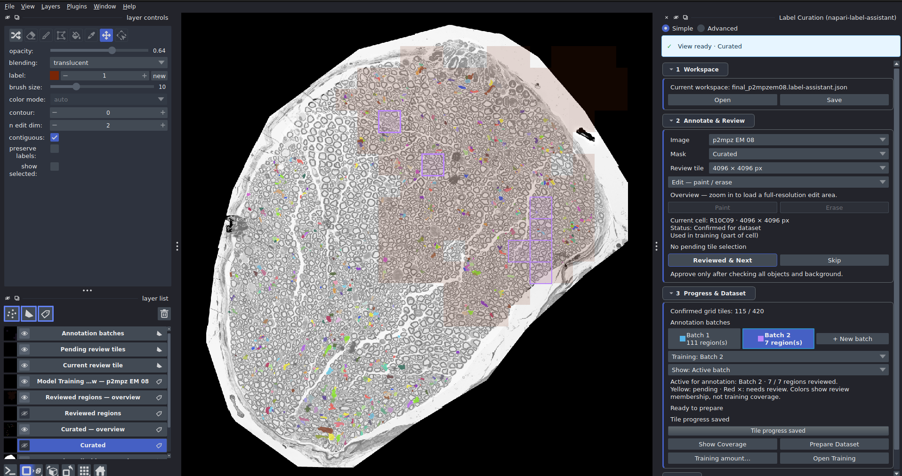
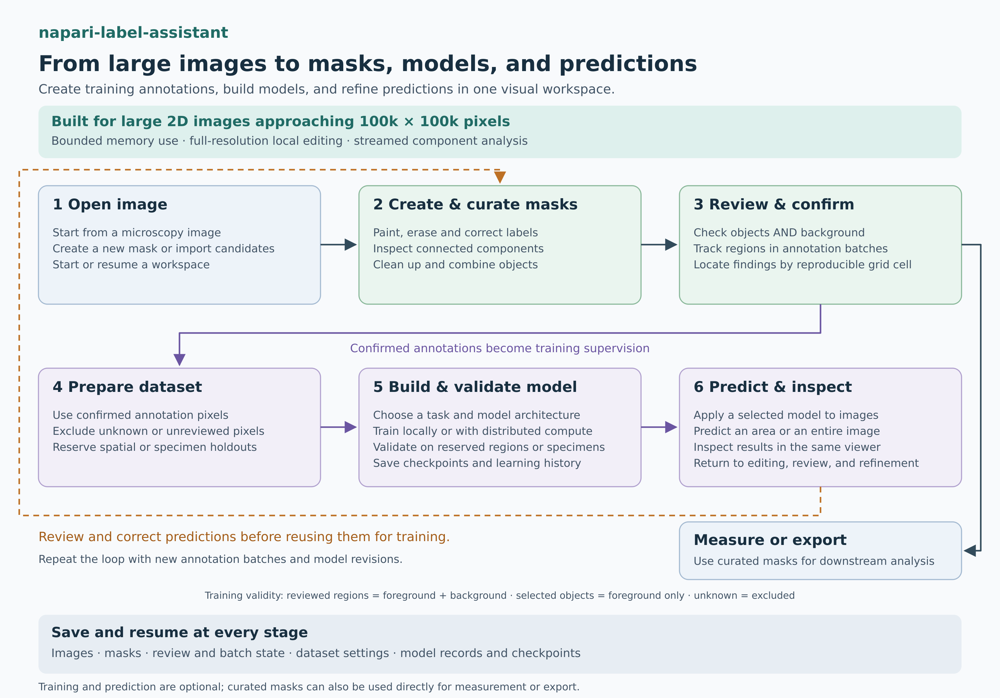

# napari-label-assistant

**Performance-aware 2D mask annotation, connected-component curation, and
traceable spatial review—from ordinary images to datasets approaching
100,000 × 100,000 pixels.**

napari-label-assistant connects the complete mask-development workflow:
annotate at full resolution, inspect connected components, collect accepted
regions into a curated Labels layer, review the result by reproducible grid
address, correct reported locations, and resume the project later.

The plugin is model-agnostic. Candidate masks can come from manual annotation,
SAM3, or another segmentation workflow. The final curated layer can then be
used for training, measurement, quantification, or export.



**Simple mode in napari:** edit masks, approve reviewed tiles, track annotation
batches in color, and prepare training data from one dock panel. Purple outlines
show the active batch's approved regions. [Open the full-size GUI screenshot](docs/simple-mode-gui.png).



[Open the editable purpose flowchart](docs/purpose-flowchart.svg).

See the [system design map](docs/system-design.md) for the architecture,
source-module responsibilities, and data flow
([PNG](docs/system-design.png) · [editable SVG](docs/system-design.svg)).

## Simple annotation workflow

Open **Plugins → napari-label-assistant → Label Curation — Simple** for a
compact tile workflow. **Label Curation — Advanced** opens the same dock with
all existing controls. Switching modes preserves masks and pending selections.

1. **Workspace:** open a project, or save a new one once to establish durable
   mask storage and tile-progress recovery.
2. **Annotate & Review:** choose an aligned image and mask, set the review-tile
   size, and paint or erase in **Edit** mode. Camera follow loads bounded
   full-resolution areas when zoomed in; zooming out provides a read-only overview.
   **Reviewed & Next** approves the current tile and visits the next unreviewed
   tile. Approve only after checking every target and the remaining background.
3. To select several checked tiles, choose **Review — select tiles** and click
   their grid cells. Click again to deselect, then **Approve selected tiles**.
   Approved coverage remains visible in color. Yellow selection alone does not
   approve annotations. **Skip** visits the next unreviewed tile without changing
   pending selections. Return to **Edit** to paint.
4. **Progress & Dataset:** inspect coverage, prepare the dataset, and open Training.
   Preparation reuses existing training settings; patch size remains independent
   of review-tile size and the camera-follow edit buffer.
   **Training amount…** opens the percentage/count controls for quick trials.

**Annotation batch buttons** live in Simple **3. Progress & Dataset**, Advanced
**Labels → Local Editing → Confirm tiles for dataset**, and **Training → Dataset**.
They share batch settings per image/mask pair. Click **+ New batch** before starting
the next annotation stage: the new batch starts empty and is selected for training.
Subsequent approvals join it. Batch buttons select
the active batch for annotation and viewing; they leave the training dropdown
unchanged. Choose **Training: Batch N** explicitly for preparation, or
**Training: all reviewed annotations** for cumulative data.
Global reviewed coverage keeps increasing independently of batch membership.
Each batch keeps its own color, matching its button marker. **Show: Active batch /
All batches / Hide** controls the coordinate overlay independently of training.
Approved regions keep their colors automatically; earlier batches are dimmed in
All batches, with active-batch priority at overlaps. Yellow marks pending tiles;
a red × flags batch regions that need review again after edits or revocation.
Right-click a button to add existing reviewed selections, remove membership,
rename, finish/reopen, or inspect dated review actions and recorded training use.
An empty batch disables preparation. Existing review coverage is retained as
Batch 1 when batches are first initialized; missing historical approval dates
remain unknown. Existing workspaces retain cumulative training by default.

To continue a model with new annotations, create the next batch, review its
regions, prepare that batch, select the saved model, and choose **Continue
training**. Earlier holdout regions remain reserved, and batch selection/version
is recorded with the training run. Membership is stored as coordinates without
copying the full image/mask. Historical runs retain their input fingerprints and
coordinates; batches do not freeze old annotation pixel values.

Pending selections use a light yellow fill and a border kept approximately three
screen pixels wide, so selected tiles remain noticeable when zooming out.
Tile selection saves show a busy indicator and a saved/error status. Approval,
revocation, and review undo show the actual completed tile count; stopping a batch
retains its partial count rather than displaying full completion.

Collapsed **Tools** includes clearing pending selection, revoking selected/current
or all reviewed areas for the chosen image/mask pair, and undoing the last review
action. Painting invalidates affected approval and review undo; recorded past
training use remains visible. Existing comparison, composition, component screening,
and workspace options remain accessible in Advanced.

After the first workspace save, pending selections and review metadata are
recorded automatically in a small `tile-progress.json` inside the workspace data
folder. Mask pixels use the existing bounded write/recovery mechanism. This is
tile-progress recovery, not a replacement for **Save**: save added layers, models,
and other project settings normally. Recovery is tied to the saved manifest and
matching source stores; incompatible records are reported and left unapplied.
Keep the JSON project and its data folder together. Existing workspaces remain
compatible; editing alone never confirms background.

## Version 7.0.0: Simple curation and annotation batches

- Choose Simple or Advanced mode, sharing the same annotations and review state.
- Edit bounded mask areas and approve review tiles from the Simple workflow.
  Recover pending selections and tile progress after reopening a saved workspace.
- Organize reviewed regions into named batches with persistent colors, review
  history, and independent display and training selections.
- Prepare all eligible training patches or a reproducible percentage/count subset.
  Quick trials can also sample validation while retaining reserved holdout regions.
- Configure wider U-Nets, retain existing checkpoint architectures when continuing,
  and save models with readable automatic filenames and training provenance.
- Preserve existing workspace and checkpoint compatibility, with bounded operations
  for large disk-backed masks. See [release notes](CHANGELOG.md#700---2026-11-19).

### Earlier: tile confirmation and whole-mask analysis (6.4.0)

- **Edit & Confirm:** retain camera-follow painting, bounded edit crops, undo/redo,
  and save/load. Confirm fully reviewed tiles, including objects and checked
  background, from the same panel. Unconfirmed areas remain excluded from training.
- **Mask Analysis & Cleanup:** **Find components** defaults to **Entire mask —
  full resolution**, independent of zoom. Stream OME-Zarr `s0` in bounded chunks,
  join components across chunk boundaries, and inspect the population in the
  sortable table. **Current edit area** remains available for local searches.
- **Global cleanup with recovery:** locating, picking, copying, noise filtering,
  and undo use full-image coordinates without loading the complete mask into RAM.
- **Simpler partial-training preparation:** Dataset displays confirmed-tile counts,
  editor navigation, and training/validation overlays. Missing single-image review
  associations recover automatically; older foreground-only selections stay under
  advanced controls. Edits require rechecking affected approvals.
- **Reliable coverage and shutdown:** preparation respects exact saved approval
  rectangles, viewing-crop navigation preserves unchanged prepared datasets, and
  closing the app no longer triggers review callbacks against a deleted canvas.

Full read-only validation of one **49,976 × 59,716** curated mask found **16
connected components** in approximately **30 seconds** in the validation
environment. This is a dataset-specific measurement, not a general performance
guarantee. See [whole-mask validation](validation_reports/17_entire_mask_analysis.md).

### Existing automatic editing and loading

- **Automatic camera-follow editing:** keep complete Zarr masks on disk and
  zoom in to paint bounded full-resolution areas. **Edit at View Center** stays
  visible; editing modes and grid navigation are under collapsed **Advanced**.
- **Fast opening for older workspaces:** saved full-mask loading settings now
  migrate to bounded loading before napari constructs the Labels layers. Opening
  leaves the original JSON and masks unchanged; the next Save records the new mode.
- **Bounded whole-mask display:** use Spatial Assistant's overview policy to
  expose only GPU-safe pyramid levels, preserving source alignment, colors, and
  full-resolution edit crops. Resolution locks cannot expose the full mask.
- **Simpler annotation and training controls:** main tabs are **Workspace,
  Labels, Training**. Review stays in Edit & Confirm, with collapsible View &
  Compare and Label Tools. Dataset summarizes supervision and preparation state;
  component selections live under **Advanced: saved object selections and coverage**.
- **Full-source label tools:** relabel, merge, compose, vote, and consensus
  operations stream disk-backed masks in bounded tiles. Results keep full image
  dimensions and become durable with workspace Save.
- **Existing annotation protections:** changed-region writes, interrupted-write
  recovery, external-edit conflict checks, complete affine transforms, source
  label IDs, and binary/multiclass/multilabel training remain supported.
- **Validation evidence:** see the [audit and follow-up reports](validation_reports/README.md)
  for executed tests, remaining findings, and limits. Large logical dimensions
  do not imply every operation fits in memory or that full-image performance
  has been benchmarked on ordinary computers.

### Overlapping multilabel masks

Training now supports three annotation formats:

| Format | Annotation layers for each image | Prediction |
|---|---|---|
| Binary | One mask: background 0, target 1 (existing instance IDs also become foreground) | One foreground mask |
| Exclusive multiclass | One mask: background 0, named classes 1, 2, … | One class ID per pixel |
| Overlapping multilabel | One binary 0/1 mask per named feature | Separate masks that can overlap |

For a macrophage and its organelles, create aligned **cell**, **mitochondria**,
**nucleus**, and other binary mask layers. Paint the whole cell including its
organelles in the cell mask. In **2. Models**, choose **Separate masks —
overlapping channels**, then open **1. Dataset → Manage channels…**. Name the
features directly in that dialog and assign their masks. For one image, **Use
mask layers as channels** fills the names/assignments from the existing Labels
layers and includes the image. You do not need to rename the layers. Names can
also be entered in Models. Do not combine overlapping masks into one integer
layer. Existing trained tasks are preserved by creating a separate task when the
channel definition changes.

**Foreground pixels → Binary 0/1** requires binary targets. Choose **Any nonzero
ID** when a mask contains object IDs such as 2, 3, and 4 that all represent the
same feature. The one-image shortcut chooses this explicitly displayed mode;
training reads a binary view without modifying the original labels.

Choose **Complete** only when that channel is fully annotated, **Partial** with
its associated reviewed-region mask, or **Unknown / not annotated** when its
labels are absent on an image. Unknown pixels do not become background. Prepare
the dataset and train with **All patches**. One image reserves spatial groups;
several images reserve entire image/specimen groups. Each split needs known
positive and negative examples for every channel.

Inference thresholds each channel independently and creates separate named
Labels layers. A pixel can belong to both cell and mitochondria. This supports
overlap but does not enforce containment or assign organelles to cell instances.
Channel definitions, assignments, checkpoints, and output metadata persist with
the workspace. Existing one-mask workflows remain available.

## Multiple-image datasets, multiclass training, and tiled inference

- **Train across image–label pairs:** in **1. Dataset → Advanced source options**, choose **Multiple images**
  and open **Manage pairs…**. Select pairs, configure annotation coverage per
  image, and keep related images in the same specimen/split group. The table
  opens separately, and review controls remain collapsed until needed.
- **Learn separate tissue classes:** define foreground classes such as
  `axon, myelin` on a new biological task. Labels use `0` for background and
  `1`, `2`, … for the named classes, up to 254 foreground classes. Class names
  persist with checkpoints, and validation reports per-class Dice/IoU. Empty
  class definitions preserve binary foreground/background training.
- **Predict more than one crop:** **4. Inference** offers **Current area**,
  **Entire image**, and **Drawn box**, with overlapping tiled prediction,
  progress, and cancellation for larger regions.
- **Save replaced labels reliably:** saving a NumPy replacement of a previously
  Zarr-backed Labels layer persists its current pixels instead of failing on a
  stale storage reference. Prediction class metadata also survives workspace saves.

Pair selections use stable layer IDs and persist in the workspace. Suggested
pairs require explicit inclusion; predictions require review confirmation before
being used as ground truth. Existing single-pair datasets, binary checkpoints,
biological tasks, and Model Library records remain supported. See the
[changelog](CHANGELOG.md) for release details and the training guide below for
the complete workflow.

## Model Library and workspace file management

The plugin menu provides:

- **Label Curation — Simple / Advanced** — two presentations of one shared
  annotation dock, for tile review or the full editing and analysis controls.
- **Model Training** (formerly Quick Train) — prepare datasets, configure models,
  train, validate, and predict.
- **Model Library** — organize models and checkpoints, document training runs,
  and compare recorded results across models. The Models page in Model Training
  also provides an **Open Model Library** shortcut.

Model Library shares the workspace's existing records; browsing does not load
model weights. **Models** lists model families and their latest recorded runs.
**Training History** shows one row per recorded run/checkpoint, with its own
scores, architecture, dataset snapshot, settings, duration, and file availability.
Use **Edit selected model / run documentation** to name a model or dataset, add
run notes and tags, or mark a favorite. Save the workspace to persist these edits.

Search and filter by task or dataset. **More filters** includes favorites,
maximum parameter count in millions, and matching dataset/validation provenance.
**Show all history columns** exposes training settings, annotation coverage,
patch counts, source layers, checkpoint paths, and stable identifiers. Older
records with missing information display an unknown value rather than borrowing
the latest checkpoint's results.

Select multiple history rows with Ctrl/Shift-click and choose **Compare selected
runs**. Available charts show validation metrics, score versus parameter count,
results in date order, and learning curves. Export history as CSV and charts as
SVG or PNG. The library assigns a best recorded score only when the selected runs
share recorded dataset and validation provenance; other comparisons are labeled
exploratory. Validation-selected scores are not independent test-set results.
Parameter count describes model size, not measured inference speed or memory use.

**Select checkpoint** shares that checkpoint with Model Training for continuation
or inference, opening the training panel if needed. **Import checkpoint** adds an
existing plugin checkpoint through the training loader. **Inspect loaded weights**
shows tensor shapes, parameter counts, and bounded-sample statistics with CSV
export. Inspection requires explicit weight loading; weight statistics do not
measure prediction quality. Learning curves read existing in-memory history or
JSON sidecars, and are reported unavailable when neither is present.

### Workspace-owned model files

The workspace is the catalog for its images, annotations, models, and results.
**Search workspace** filters registered model/run records, including checkpoint
paths and file status. It does not scan folders, discover unregistered `.pt`
files, or search the **Recent workspaces** list. Open the relevant workspace
first; its model records are restored without loading networks.

In Model Library, expand **Model files and workspace locations** to see the
workspace manifest, managed-model folder, selected checkpoint path, and counts
of **Managed**, **Linked externally**, **Missing**, and **Unsaved** checkpoints.
Use **More filters → File status** to find missing or externally linked files.
The Workspace panel's **Open Model Library** shortcut opens this same catalog.

```text
MyProject/
├── MyProject.label-assistant.json
└── MyProject_label_assistant_data/
    ├── models/       # checkpoints, histories, metrics, and learning charts
    ├── comparisons/  # saved comparison reports
    └── …             # managed image/annotation assets
```

- **Managed** files are saved inside this workspace's models folder.
- **Linked externally** files remain at their recorded external locations.
  **Copy into workspace** copies a selected checkpoint and its available history,
  metrics, and chart files into managed storage while preserving the originals.
  Existing bundles are not overwritten; copying runs in the background.
- **Missing** files can be repaired with **Locate missing file**. The selected
  file is checked against the model identity, configuration, recorded training
  history, and scores before the run reference is changed. A different model or
  checkpoint revision must be imported separately.
- **Unsaved** weights must be persisted with Workspace Save before copying.

**Save the workspace after copying or locating a file** to persist its updated
references. These actions preserve model/run identities, notes, and history;
they do not add another training run or move source files. A workspace change
during an operation prevents its result from modifying the newly opened catalog.
**Open models folder** opens the managed folder in the desktop file manager.
Images may remain linked externally; making model files managed does not copy
large image datasets or make the entire workspace portable. Use **Include all
data (portable)** when the entire workspace needs to move between computers.

## Prepared datasets and checkpoint selection

- Selecting an existing model or loading a checkpoint now retains a compatible
  prepared dataset, so **Train new model** remains available without repeating
  preparation. The current dataset's validation settings and partition stay intact.
- Checkpoints that previously trained in the reserved validation regions cannot
  continue training against that holdout; training a new model remains available.
- Both **Prepare dataset → select model → train** and **select model → prepare
  dataset → train** are supported. After changing annotations, sources, or dataset
  settings, prepare the dataset again.

### Annotation and review workflow

- Finish a cell with **Confirm tile & next** directly in Edit & Confirm; move
  to the next unreviewed cell without switching to Training.
- See the shared image/annotation pair in editing and training, with associations
  remembered in workspace metadata and clear training/prediction prerequisites.
- Preview cleanup counts and use **Undo last deletion** for component deletion
  and cleanup, including disk-backed masks. Recovery preserves later nonzero
  edits and lasts until another deletion starts or the panel closes.
- Distinguish applied mask edits from saved workspace settings, with visible
  change tracking and successful save/open timestamps.

Training and model management also support these workflows:

- Follow five Training pages: **Dataset**, **Models**, **Train**, **Inference**,
  and **Advanced**. Prepare datasets separately from optional patch previews.
- Combine fully reviewed cells with selected component foreground. Persistent
  library IDs and selections survive workspace saves and reopening.
- Choose the existing custom U-Net, standard U-Net, optional SMP architectures,
  or registered custom providers; organize checkpoints and compare models.
- Evaluate with spatial holdout or independent spatial k-fold validation, inspect
  learning curves, and export models and reports.
- Configure augmentation, learning-rate reduction, and early stopping. Use batch
  sizes up to 128, source patches up to 4096, and model inputs up to 2048.
- Save model weights and per-run checkpoints with the workspace; complete-package
  Save As includes model assets and reports. Older workspaces remain readable.

See [CHANGELOG.md](CHANGELOG.md) for the complete release notes.

## Workflow at a glance

1. **Edit & Confirm:** create, extend, erase, or reshape labels at full
   resolution through a memory-controlled editable area when needed.
2. **Inspect:** analyze each nonzero label value as one or more connected
   components and sort the results by size, topology, position, or grid
   address.
3. **Curate:** remove artifacts and copy accepted components from candidate
   masks into a curated destination Labels layer.
4. **Review:** register findings with grid addresses such as **R12C08**, so an
   independent reviewer and annotator can refer to the same location.
5. **Correct and resume:** return to a reported cell, update the source mask,
   save the project, and continue later with the same layer and viewer state.

## Everyday workflow shortcuts

- **Labels → Edit & Confirm** shows the image and annotation pair shared with
  Training. After checking every object and the background in a selected grid
  cell, use **Confirm tile & next** to include it in training and move to the
  next unreviewed cell. Navigation wraps at the end of the image.
- Training shows the missing prerequisites for training and prediction. Image
  and annotation associations are remembered in workspace metadata.
- Component cleanup previews the number of components and pixels affected.
  **Undo last deletion** restores the most recent component deletion or cleanup,
  including on disk-backed masks, while preserving subsequent nonzero edits.
  This recovery is available until another deletion starts or the panel closes.
- Applied paint edits update the source mask. **Workspace Save** preserves the
  project and its settings separately; the Workspace panel shows recorded changes
  and the time of the latest successful save or open.

## Connected-component inquiry and curation

The component table turns a segmentation mask into an inspectable set of
regions. It is designed to remain usable when the mask contains many
components and the full image is too large for naive in-memory analysis.

- Detect connected components independently within each nonzero label value.
- Sort by label value, pixel count, Euler number, centroid, bounds, or grid
  address.
- Double-click a table row to locate its component on the canvas.
- Click a labeled region on the canvas to select its table row; optionally add
  successive clicks to a multi-component selection.
- Delete noise and other unwanted regions individually or in batches.
- Copy accepted components individually or in batches to a compatible curated
  destination Labels layer.

Euler number provides a compact 2D topology check: `1` indicates a solid
component with no holes, `0` indicates one hole, and `-1` indicates two holes.
Combined with area sorting, this helps distinguish small artifacts, solid
blobs, ring-like structures, and components that merit closer inspection.

Component IDs identify results within the current analysis. Editing the mask
and running the analysis again may change those IDs. Grid addresses provide
the reproducible spatial reference used across review sessions.

### Candidate and curated Labels layers

A practical workflow uses two roles rather than requiring every segmentation
result to be edited in place:

- **Candidate layers** contain model predictions, partial masks, or regions
  awaiting review.
- **Curated destination layers** collect accepted annotations for downstream
  training, measurement, quantification, or export.

Candidate regions produced by SAM3 are one example, but the same workflow
works with any compatible napari Labels layer. Users can inspect candidates
visually, select them from the table or canvas, and copy only accepted regions
into the curated layer.

## 100,000 × 100,000-pixel workflows

**Automatic mask loading now keeps large 2D Zarr masks outside napari's layer
list.** Open the existing workspace normally: the multiscale image remains
available, while Curated and review masks appear as editable 1024 × 1024 crops.
The complete masks stay in their original on-disk stores; no manual crop files
or final stitching step is needed.

Under **Labels → Edit & Confirm → Mask editing**, zoom in and paint. New
workspaces use bounded editing with camera follow by default; no editing-mode
choice is needed. **Edit at View Center** remains visible for manual control.
The collapsed **Advanced** section contains the editing-mode selector, camera
follow toggle, and grid controls: 512–4096-pixel tile sizes, zero-based row/column
addresses, **Go**, **Previous**, **Save & Next**, and **Save navigation progress**. Older projects
saved with full-mask loading now open through bounded crops automatically.
Opening a project does not rewrite its JSON or masks; the next Workspace Save
records the bounded mode. An explicit editing-mode choice in Advanced takes
precedence for the current session. Saved camera-follow preferences are retained.
Small in-memory masks can still be painted directly before their first save.

Camera follow loads full-resolution edit windows as you zoom in and pan.
Windows use at most 4096 × 4096 pixels,
with a combined mask read limit of 128 MiB. Zooming out switches to a read-only
overview. Following waits for strokes and navigation drags to finish and saves
pending edits through the same recovery journal before changing the area.
**Edit at View Center** and the grid navigation buttons remain available;
automatic following resumes when the view changes. Workspace Save remembers
the follow setting. Differently registered masks require manual navigation;
automatic following pauses with an explanation and retains the current buffers
if loading or saving fails.

Mask overviews follow Spatial Assistant's display policy: napari receives only
pyramid levels within the GPU texture limit, capped at 4096 pixels per axis and
64 MiB per level. An 80,000 × 80,000 mask uses the 2500 × 2500 and smaller
levels on a GPU that supports 4096-pixel textures. Full-resolution editing stays
in the local crop. Overview coordinates, crop exclusion, and label colors remain
aligned; the display policy also applies when previews are rebuilt after Save.

Edits, including erasures, update only their changed bounding region in the full
mask. Writes use a bounded recovery journal and reject conflicting external
edits or out-of-range label values. Paint changes normally flush after a short
idle delay, and saving/navigating/closing also flushes pending edits. If storage
fails, retain the reported recovery files and resolve the error; unresolved
conflicts are not silently overwritten. Undo history is local to the active tile
and is reset when its pixel buffer is replaced.
Use one editing session per mask store; conflict checks are not a multi-user
locking protocol.

**Include all data (portable)** still copies the complete source masks, not only
the visible crops. New aligned masks matching the active tile are backed by
sparse full-size stores and become durable with workspace Save. Full-image
training reads the backing masks rather than mistaking the displayed crop for
the dataset. Component analysis defaults to the entire full-resolution mask;
the optional current-area mode describes only that crop, where boundary objects
may continue into neighboring areas. The training component
library still scans the full backing mask in bounded chunks, and selecting a
library object loads its tile. After checking a review tile, confirm it under **Edit & Confirm → Confirm tiles
for dataset**. Confirmation includes annotated objects and checked background;
unconfirmed regions remain excluded. Approval uses sparse full-size coverage and
bounded writes. Save the workspace to preserve it.
**Save navigation progress** records navigation only. Review-tile height and width
do not change the separate **Editable tile size**, which supports custom sides up
to 4096 pixels and camera following. Green outlines show approval; blue outlines
show historical training use. Editing invalidates approval without erasing that
history.

This path applies to 2D Zarr Labels stores. It reduces mask display/working memory;
source chunk sizes, storage speed, image rendering and other analyses still
affect responsiveness. It does not establish a hardware-independent performance
guarantee or remove full-image inference's output-memory requirements.

A 100,000 × 100,000 label mask contains 10 billion pixels. Default bounded
editing keeps the source store outside napari's editable layers, displays a
small overview, and loads only a camera-centered crop for full-resolution edits.

At this scale, the source should use an efficiently sliceable, preferably
chunked or on-disk array such as Zarr. Actual responsiveness depends on array
storage, chunk geometry, data type, disk performance, available memory, and
hardware. The numeric scale describes the intended workflow, not an
unconditional hardware-independent limit.

## Interface

The dock widget has three main tabs: **Workspace**, **Labels**, and **Training**.
Labels contains **Edit & Confirm** and **Mask Analysis & Cleanup**.

### Workspace

Open **Plugins → napari-label-assistant → Label Curation**, then use the first
**Workspace** tab to create, open, and save a complete annotation workspace
without SAM3 Assistant.

- A normal save writes a small `.label-assistant.json` manifest.
- **Optimize large images** optionally creates a local, chunked
  multiscale OME-Zarr pyramid for single-scale images larger than 32,768
  pixels on either axis. The original file remains unchanged; the saved
  pyramid is activated automatically after a successful save. Leave the
  option off to keep lightweight links to the original image files.
- New in-memory Labels layers are persisted once as writable, chunked
  OME-Zarr data beside the manifest. Later saves reuse the same store instead
  of copying the full mask again.
- **Data storage for next save → Include all data (portable)** saves every image
  and mask into the data folder beside the manifest with relative paths. Select it and
  use **Save As** in an empty folder, then transfer that **entire folder** to
  another computer. Open the manifest there; original source paths and reader
  plugins are no longer needed. It also supports fileless and multiscale images
  and can be combined with image optimization. Allow time and disk space for
  copying full datasets.
- Saved image copies become the live data source after the save succeeds;
  no close/reopen is needed before using **Link to source data** for fast
  follow-up saves. Repeated saves to the same portable package also reuse its
  existing image stores. **Save As** to a different destination still creates
  independent mask copies, and includes image copies when portable mode is on.
- With **Link to source data** selected, **Save As** to a new destination creates writable mask copies beside the
  new manifest, including masks opened read-only from shared mounts. Images
  remain linked; keep the shared mount available when reopening locally.
  Saving to the current project path reuses its existing mask stores.
- Saving displays progress; failures show an error dialog and keep the previous
  active project selected.
- Source images already loaded from files remain external references, keeping
  routine saves fast. **Portable Snapshot** explicitly copies referenced local
  images and masks into one folder for transfer.
- Pending local-area edits are applied to the source Labels layer before the
  project is saved.
- The JSON file is a lightweight project manifest rather than a container for
  the full image. Large mask pixels remain in writable OME-Zarr storage.
- A recent project is not treated as the active Save destination for unrelated
  viewer contents. Before a manifest is overwritten, its previous version is
  retained as a `.backup.json` file.
- Grid cell dimensions and grid display/assignment choices are restored with
  each Labels layer.
- Opening a project displays layer-by-layer progress in a temporary dialog;
  the dialog closes automatically when loading succeeds or fails.
- Temporary editable-area, editable-boundary, and grid-overlay layers are not
  stored; the plugin recreates them when needed.

Existing `.sam3.json` projects created by SAM3 Assistant can be opened for
migration. Use **Save As** to continue with the standalone `napari-label-assistant`
format.

### Labels

Choose a Labels layer for editing and QC:

- **Edit & Confirm** contains the memory-controlled Paint and Erase workflow.
  It edits a bounded local view and applies changes to the selected source
  Labels layer.
- **Mask Analysis & Cleanup** inspects the current Labels area through grid
  registration, component actions, canvas selection, and an expandable
  results table for large result sets. Training confirmation stays in Edit & Confirm.

Layer selectors update automatically when layers are opened, added, removed,
or renamed. **Refresh layers** remains beside the shared Labels-layer selector
as an always-visible fallback; it is no longer buried among component actions.

Mask Analysis & Cleanup's **Screen & Group Objects** keeps the group destination
beside **Copy selected**. Enable **Select components from canvas** and **Keep
earlier component selections**, then click objects belonging to a human-defined
group, such as Remak bundles. Objects may have different source label values.
Cyan selection boxes identify the pending objects without changing their pixels;
click a selected object again to deselect it, or use **Undo selection** and
**Clear selection**. **+ New** names a destination; its Labels layer is created
when objects are copied. Right-click selected rows → **Copy selected to → New
group…** names a group and copies the selection. Copies retain source values and
image coordinates. Enable **Clear selection after successful copy** for batches;
cancellation and failed copies retain the pending selection.

Workspace Save preserves pending selections separately for each source and group.
After reopening, **Find components** checks and restores matching objects. Source
values, bounds, pixel footprints, and analysis coordinates must still match;
changed objects require reselection. Use the same analysis scope when restoring
an editable-area selection. Grouping foreground objects does not approve the
surrounding background for training. The component index is still built on demand;
large whole-mask searches remain chunked and cancellable, and can take time.

The **Group / destination** selector lists other Labels layers with the same 2D
shape and matching spatial transform as the selected source, preferring **Curated**.
Review/coverage masks and preserved originals are available only through manual
selection, so they are not accidentally chosen as an annotation destination.

Under **Advanced: grid addresses and destination matching**, enable **Choose
destination manually** to select any Labels layer or type a new
name. The first copy to an existing manual destination shows both layer names
and dimensions, with **Copy** and **Cancel**. Cancel changes no layers or pixels;
repeated copies to the confirmed destination do not keep prompting.
Switching to a different destination asks again.

Crop-sized masks copy at their original image coordinates into a larger
destination, including its on-disk full mask in grid mode. **Curated is not shrunk
to the prediction crop.** Otherwise, a matching destination is prepared under the
chosen name. The previous layer is preserved, hidden, as **<name> — original**.
Existing overlapping annotations transfer where their pixel grids align exactly;
larger transfers run in bounded, cancellable chunks. There is no silent
resampling. Annotations outside the new canvas or on a different pixel grid remain
available in the original layer.
Stopping an in-progress transfer keeps completed pixels; the initial confirmation's
Cancel button stops before any copying or matching. Existing model/review
associations stay with the preserved original when a replacement is created.

Right-click selected rows → **Restore original destination before matching** to
restore the original layer and keep the copied result separately. If there is no
compatible destination yet, **Copy selected** or the context menu's **Prepare
matching Curated and copy** starts the matching workflow instead of showing a
disabled “no same-size targets” dead end. The source cannot copy into itself.

Workspace saves preserve these complete transforms, including crop offsets in
prediction layers. Older workspaces with only scale and translation remain
readable. Local editable areas and their boundaries inherit the source mapping;
changing the source transform updates those helpers without resampling pixels.
Combine operations also require aligned masks and preserve the reference transform.

To clean isolated specks, run **Find components**, set **Remove below** (default:
**2 pixels**), and click **Remove small components**. This sets every connected
component with an area strictly below the threshold to background (0), and
removes it from the results across all pages. Components exactly at the threshold
are kept; no row selection or sorting is needed.

The fixed top header is a compact activity indicator that confirms when napari
is preparing a layer view and when the local editable area is ready. It uses
short states such as **Preparing view**, **View ready**, and **Edit area ready ·
4096 × 4096**. Long layer names are shortened visually without changing the
dock or table geometry; the full status and product description remain in the
header tooltip.

**Mask editing** follows the camera by default for bounded workspace masks.
Zoom in to edit and zoom out for an overview. **Edit at View Center** provides
manual control. **Advanced** retains size-based Automatic, Local-area, and
Full-layer editing for older workflows, along with manual grid navigation.

**Connected-component analysis** provides measurement and region-management
tools. Canvas picking finds components automatically and pauses painting;
**Find components** also populates the table manually. You can:

- click a column heading to sort the table;
- double-click a result row to center that component in the viewer;
- enable **Select components from canvas** to select a table row by clicking
  the labeled region;
- enable **Keep earlier component selections** to enable picking and build a multi-component selection;
- use **Delete selected**, **Copy selected**, or **Remove small components** as needed.

The results table reports component ID, source label, pixel count, Euler
number, centroid, and bounds. Optional grid columns report the grid row,
column, and cell containing each component centroid.

### Training

Training has five pages: **1. Dataset** for confirmed tiles, preparation, and optional patch previews; **2. Models** for biological tasks, architecture selection, checkpoints, training history, and controlled comparisons; **3. Train** for training and validation; **4. Inference** for predictions; and **5. Advanced** for patch size, model input size, optimization, and augmentation. Progress and Cancel remain available across pages. Models supports the existing custom U-Net, a standard U-Net, and optional SMP U-Net, U-Net++, and DeepLabV3+ encoders. Prepare dataset enables training without adding canvas layers. Show patch preview is optional and displays a separate contact sheet beside the image; Return to image restores the previous view. Workspace Save includes changed model weights; standalone export remains available. See [model management and benchmarking](docs/model-management.md) for the workflow and optional dependency installation.

For partial annotations, open **Labels → Edit & Confirm**. Set the review-tile
height and width, inspect all objects and background, then choose **Confirm tile
for dataset** or **Confirm tile & next**. Enable **Click tiles to confirm for
dataset** to approve successive fully checked tiles directly on the canvas.
Turn selection off to paint again. **Go to dataset preparation** opens Training.

**Training → Dataset** shows confirmed-tile counts and preparation status.
**Edit & confirm tiles…** returns to the editor; **Show confirmed tiles on image**
displays approval outlines. After preparation, **Show training / validation
patches on image** locates the current dataset partitions. Model patch sizes
remain in **5. Advanced**, independent of review-tile size and editable crop size.

Saved foreground-only object selections remain available under **Advanced: saved
object selections and coverage**. They are preserved when reopening or saving a
project. Selecting a component in **Mask Analysis & Cleanup** is for inspection,
copying, or deletion; it does not approve training data. Cleanup that changes
confirmed pixels requires rechecking the affected tiles.

Dataset now presents one training-data overview: annotation-source counts,
supervision information, and No eligible annotations / Ready to prepare /
Prepared / Outdated states. Exact foreground, background, and unknown pixel
counts appear after indexing, along with training and validation patch counts.
Unknown pixels never become negatives implicitly. Individual positive-only
patches remain supported within mixed datasets; the existing validation policy
requires targets and verified background in both splits. Selected objects alone
therefore require additional background review before preparation.


**Training** trains the selected model from reviewed image/ground-truth patches
and previews a bounded area of another image as a new Labels layer.

Install training dependencies in the Python environment used to launch napari.
From this repository, use `python -m pip install -e '.[train]'`. For SMP models,
use `python -m pip install segmentation-models-pytorch`, then verify with
`python -c "import segmentation_models_pytorch as smp; print(smp.__version__)"`.
Restart napari from that same environment after installation. See
[SMP installation and troubleshooting](docs/model-management.md#installing-and-checking-smp)
for environment checks and dependency errors. PyTorch is loaded only when
training, prediction, or model loading is requested; other tools work without it.

1. Open **Training → 1. Dataset**, or the plugin's **Model Training** panel.
   Choose **Current pair** for one single-channel 2D image and its aligned
   ground-truth Labels layer, or **Advanced source options → Multiple images → Manage pairs…** for several.
   Use complete coverage only when the entire image is annotated; partial
   annotations require associated reviewed regions and/or selected objects.
2. In **2. Models**, choose a biological task and architecture. Leave
   **Foreground classes** empty for binary training, or define semantic classes
   and use their numeric IDs consistently in every included Labels layer.
3. Return to **1. Dataset** and click **Prepare dataset**. The default
   **All / selected training patches** workflow indexes eligible patches and streams them during
   training. Set source patch and model input sizes in **5. Advanced**;
   defaults are 512 × 512 pixels. Preparation locks included annotations,
   supports cancellation, and does not open a gallery automatically.
   Under **Training patch selection**, keep **All**, choose a **Percentage**, or
   enter a **Patch count**. This samples the smaller model patches across approved
   regions; it does not revoke review tiles. For example, 10% of 1,225 training
   patches selects 123. The subset seed makes selection reproducible, and changing
   the budget reuses the prepared index. Foreground/background patches are sampled
   proportionally; invalid subsets report which supervision is missing.
4. Optionally click **Show patch preview**. Cyan frames mark training patches
   and orange frames mark validation. Double-click a tile to locate it in its
   source image. **Return to image** hides the read-only gallery. Single-pair
   datasets reserve spatial blocks; multiple-pair datasets reserve entire
   image/specimen groups. Review the indexed counts and validation settings.
   **Sample patches** remains available for complete single-pair annotations;
   its crop count applies to a fixed sample rather than full coverage.
5. In **3. Train**, choose epochs for **All / selected training patches** or steps for **Sample
   patches**, then click **Train new model**. Device selection is in Advanced;
   Automatic falls back to CPU when CUDA is unavailable or lacks memory.
   Changed source pixels, pair selections, class definitions, patch sizes, or
   validation settings require preparation again. Inspect validation Dice, IoU,
   precision, and recall; multiclass models also show per-class results.
   These validation-selected scores are not independent test-set accuracy.

Training subsets reuse the same chosen patches every epoch. By default, all reserved
validation patches are evaluated. For faster experiments, enable **Quick trial —
smaller validation set** and choose **Validation percentage** (default 10%). With
10% of each pool, 5,257 training / 1,813 validation patches become 526 / 182.
The validation sample stays fixed across epochs and training-subset changes,
preserves the spatial/image split, and must retain required target/background and
class/channel supervision. Scores are labeled **Trial validation**.

After a trial, use **Train → Validation → Evaluate full validation set** to evaluate
the retained weights on every reserved patch without training or reselecting weights.
Full-validation results are saved separately from trial scores; save the workspace
or export the model afterward. Change **Subset seed** to try different training
patches, or return to **All** and turn Quick trial off for full training/validation.
Source arrays remain disk-backed; selection stores coordinates rather than image
copies, and initial preparation still indexes the eligible pool. Workspace settings
and completed checkpoints record the selection and evaluation provenance. Spatial
k-fold and final all-reviewed training retain their full-index behavior.
6. In **4. Inference**, select a **Prediction image** and choose **Current area**,
   **Entire image**, or **Drawn box**. Current area predicts one crop; the other
   modes blend overlapping tiles with progress and cancellation. Each run adds a
   Labels layer with the image transforms preserved. Review the prediction.
7. Save the workspace to persist datasets, annotations, model/run records, and
   managed checkpoints. Use **Export current model…** to export a checkpoint,
   and **Load model…** or Model Library to reuse it in later sessions.

The default custom model is a five-level U-Net with 8, 16, 32, 64, and 128 feature
channels, GroupNorm, and skip connections. Standard U-Net and optional SMP models
are also available. Binary models use binary cross-entropy plus Dice loss;
multiclass models use cross-entropy plus foreground Dice loss. Select
256 × 256 inputs for speed or 512 × 512 for more detail. At the default 512-pixel
context/resolution no downsampling is needed. Larger contexts sacrifice boundary
detail; image area averaging and foreground-preserving mask pooling retain small
targets when reducing resolution. Inspect the gallery to assess this tradeoff.
Sampled single-pair training reduces context for small images to retain separate
validation areas. Single-pair coverage needs two source patches on each axis;
reduce patch size if preparation reports insufficient spatial coverage. Models
learn from the selected annotations and require evaluation on representative new
images before relying on their predictions.

For multiple tissue features, create a new biological task in **2. Models** and
enter comma-separated **Foreground classes**, for example `axon, myelin`.
The semantic ground-truth Labels layer must use `0 = background`, `1 = axon`,
and `2 = myelin`. These IDs represent tissue types, not individual objects.
All axons share ID 1, and all myelin pixels share ID 2. If annotations are in
separate layers, **Labels → Edit & Confirm → Label Tools → Compose Layers As Distinct Classes** can prepare a
semantic layer; check class order and overlaps before training. Existing object
IDs are never automatically reinterpreted or converted.

Leave the class field empty to retain binary training (all nonzero IDs become
foreground). Class definitions are stored per task and checkpoint. A task with
trained models cannot change its class meanings; create another task instead.
Prepare the dataset again after changing classes. Both coverage and sampled
training support multiclass supervision. Each class needs examples in training
and validation regions. Partial annotations still require reviewed coverage;
unreviewed pixels and padding do not contribute to loss.

Multiclass models use cross-entropy plus foreground Dice loss and predict the
highest-probability class, including background. The binary threshold is disabled.
Validation shows foreground macro-average scores and per-class Dice/IoU.
Class masks use nearest-neighbor resizing; if a class disappears during input
downsampling, preparation asks for matching patch and input sizes. Train a new
multiclass model; existing binary checkpoints retain their original output.

Training and prediction run in background workers. **Cancel** stops after the
current crop or training step, restores editing, and keeps the existing model.
Huge NumPy/memmap, Zarr, and other sliceable sources are accessed by small
regions; the full arrays are never converted to in-memory training copies.

To train across several images, choose **Advanced source options → Source mode → Multiple images** in
**1. Dataset**, then open **Manage pairs…**. The pair table stays in a separate
dialog to keep the Dataset panel compact. Suggested associations are not included
automatically. Check each image–label pair, choose complete annotations or its
associated reviewed-region mask, and confirm reviewed/corrected model predictions
with **Labels reviewed**. Click **Apply**, then **Prepare dataset** and train as
usual. The existing **Current pair** mode remains available.

Multiple-pair mode streams all eligible patches using the **All patches** workflow.
Each image/specimen group stays entirely in training or validation; set the same
**Specimen / split group** for related images, duplicated acquisitions, or images
from one animal. Holdout requires at least two independent groups; k-fold needs
at least as many suitable groups as folds. Each split needs targets and background,
and multiclass datasets need each foreground class in both splits. Images can have
different dimensions, but each pair's shapes/transforms must align and image
scales should be comparable. Patch previews retain their source image identities.

Pair inclusion, coverage, confirmations, and split groups are saved in the
workspace using stable layer IDs, so renaming layers does not break the pairing.
Missing layers are reported for repair in Manage pairs. **Review selected pair**
opens the normal review controls when needed; those controls stay collapsed in
multiple-pair mode. Training history records every included source.

#### Continue training and history

Use **Continue training** to improve the current or loaded model. It starts from
that model's weights with a fresh optimizer. **Train new model** creates a model
using the selected initialization instead.

Prepare the dataset if needed; patch preview is optional. Set **Learning rate**
in **Advanced**, then continue from **Train**. The best validation weights are
retained, and cancellation preserves the previous model. Save again after a
completed round to persist its weights and history.

See [continuation and training history](docs/TRAINING.md#continue-training-an-existing-model)
for validation restrictions, sampling, and the exported `.history.json` file.

### Grid registration and QC traceability

The registration grid gives reviewers a reproducible address for every part of
a full 2D mask. With the same cell height, cell width, grid origin, and source
coordinate system, a reference such as **R12C08** identifies the same location
across masking, review, correction, and follow-up QC sessions—even between
collaborators.

Grid-cell size is user-defined, with a default of 100 × 100 pixels. The grid
serves both as an annotation map and as a shared review vocabulary:
screenshots, review notes, and correction requests can carry the same address
without creating or exchanging cropped coordinate systems.

- Enable **Assign grid addresses to results** to register each component by the
  grid row, column, and cell containing its centroid.
- Enable **Show address grid on canvas** to see cell boundaries and identifiers
  around the current viewport.
- Use a grid address together with a component ID—for example, “R12C08,
  component 431”—to identify a labeled region that needs correction.
- Use the grid address alone to register an unlabeled location where a
  component is missing and therefore cannot appear in the results table.

Grid addresses make reviewer findings and corrections traceable without
creating cropped copies of the source. Reuse the same grid dimensions, origin,
and source coordinate system when addresses must remain stable. The address
grid is a spatial reference system. Manual tile completion and reviewed-region
approval are separate records; it does not store reviewer comments, assignments,
or a change-history audit log.

### Labels: View & Compare

The main tabs are **Workspace | Labels | Training**. Under **Labels → Local
Editing**, expand **View & Compare** to show Image Only, Overlay, or Labels Only,
adjust Labels opacity, or temporarily Peek/Blink Labels. These controls preserve
the active editing layer and never change pixel data. **Advanced view effects**
retains Pulse, Dim, Toggle, and Restore. Both new Labels sections start collapsed.

### Labels: Label Tools

Expand **Label Tools** under **Edit & Confirm** and select an operation. Only its
relevant settings are displayed. Select compatible, aligned 2D Labels layers:

- reassign one label value;
- merge foreground regions into one class;
- compose layers as distinct classes;
- create a per-pixel vote-count map;
- create a consensus map from a minimum vote threshold.

Results create a new Labels layer by default. **Overwrite first selected layer**
is explicit and remains unavailable for vote-count maps. Large and disk-backed
sources run in bounded tiles in the background, using full source masks rather
than their display crops. Temporary results are included when saving a workspace.
These mask-composition tools do not approve tiles for training.

## Editing at 100,000 × 100,000-pixel scale

Workspace Save now builds categorical Labels pyramids (`s0`–`s6`) for 2D masks.
`s0` keeps the original editable label IDs. Lower levels are derived previews:
each 2 × 2 block keeps the first nonzero ID, preserving isolated foreground
without averaging IDs. Competing objects can share a preview pixel; measurements
and training always use `s0`. Very small masks stop before repeating 1 × 1 levels.

Large masks keep their editable grid tile and add a read-only **overview** layer
for the whole mask. Its visibility, opacity, and colors follow the source Labels
layer. Use **Show whole mask** in Edit & Confirm to zoom out; double-click while
the source or overview is selected to move the editable tile to that location.
Overview layers are excluded from annotations, training sources, and saved layer
records. Paint and erase update affected pyramid regions when edits are applied.

Older workspaces saved in full-mask mode now open through bounded crops by
default. **Advanced → Editing mode → Bounded editing** returns an explicitly
selected legacy mode to this workflow. Size-based **Automatic** also restores
bounded rendering for large disk-backed masks. Full-size renderers are removed;
the overview provides whole-mask viewing.

For existing single-resolution workspaces, Save once to build the lower levels.
This adds disk data and takes time, but processes bounded blocks instead of
loading the entire mask into RAM. A failed or interrupted build stays marked
outdated; `s0` remains the annotation source and a later Save can rebuild previews.

Default camera-follow editing keeps a bounded working region editable in
memory. Zoom in to load that region, pan to follow, and zoom out for the read-only
overview. **Edit at View Center** offers manual control. For older workflows,
**Advanced → Editing mode → Local-area editing** retains the separate editable
area and green boundary described below.

The original Labels layer remains the source of truth. Changes made in the
temporary editable-area layer are written back only for pixels that changed,
and the corresponding part of the source preview is refreshed locally. The
editable-area and boundary layers are transient helpers rather than additional
label results.

### Saving

Default bounded editing saves strokes after a short idle delay, waits for an
active stroke to finish, and flushes pending changes before navigation, saving,
or closing. These writes use the same changed-region recovery journals and
conflict checks. Workspace Save separately preserves project settings.

In the legacy **Local-area editing** mode, **Apply edits automatically** controls
synchronization:

1. Saving never starts while the paint or erase mouse button is held.
2. Releasing the mouse starts a 400 ms inactivity delay.
3. Only the accumulated changed region is compared and written to the source.

Disable automatic apply to keep changes in the local area until **Apply edits**
is clicked. A local area with unsaved manual changes remains in place during
pan or zoom, preventing accidental loss. **Undo** and **Redo** synchronize
immediately in automatic mode and remain pending until **Apply edits** in manual
mode.

Tile size controls the memory/performance tradeoff. A 2048 × 2048 area uses
less memory; a 4096 × 4096 area requires fewer reloads while navigating.

## Component analysis at full-image scale

**Mask Analysis & Cleanup → Entire mask — full resolution** searches the complete
`s0` mask independently of camera zoom and the current editing crop. This is the
default. Search streams bounded chunks, joins components crossing their edges,
and displays paged results with progress and Cancel. There is no need to enable
full-layer editing or load the complete mask into memory.

Choose **Current edit area** for local inspection; its boundaries are shown in
the panel and objects may continue beyond them. Whole-mask results use full-image
coordinates for locating, picking, copying, cleanup, and undo. Cleanup invalidates
affected dataset approvals; selecting results alone does not approve training data.

## Requirements and scope

- Python 3.11 or newer
- napari 0.9.1 or newer for the camera/canvas integration
- 2D Labels layers for local-area editing and component analysis
- aligned 2D masks for combining; registered crops or explicit destination
  matching when copying

Practical dataset size depends on array storage, data type, chunking, available
memory, and hardware. Bounded workspace editing is the default for 2D Zarr
masks. Legacy direct editing and size-based Automatic remain under Advanced.

## Installation

Install the current GitHub version (7.0.0):

```bash
python -m pip install --upgrade "git+https://github.com/wulinteousa2-hash/napari-label-assistant.git@main"
```

PyPI releases are published separately. To install the latest version available
on PyPI:

```bash
python -m pip install --upgrade napari-label-assistant
```

When upgrading from the pre-1.0 development package, remove its old plugin
registration before installing the current package:

```bash
python -m pip uninstall napari-label-assistant-tools
python -m pip install napari-label-assistant
```

Start napari and open:

**Plugins → napari-label-assistant → Label Curation**

## Development

Clone the repository and install it in editable mode with test dependencies:

```bash
python -m pip install -e ".[all,test]"
pytest
```

## License

Distributed under the terms of the MIT license.
