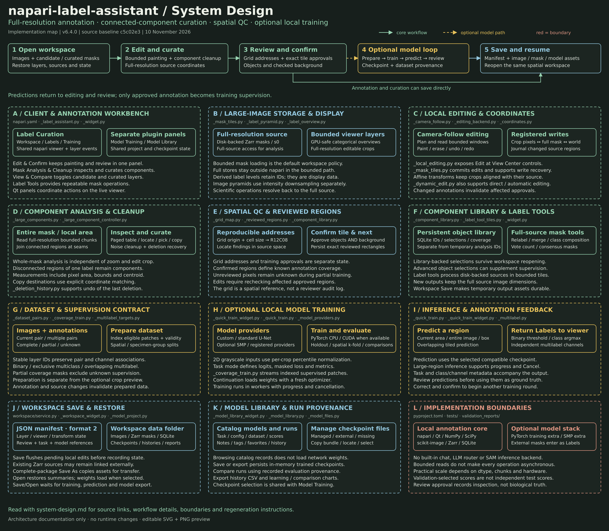

# napari-label-assistant system design

Implementation map for **6.4.0**, checked against source baseline `c5c02e3`
on 10 November 2026. The map follows the local annotation and model workflow;
the reference diagram's chat and Ollama components do not apply to this plugin.



[Open the editable, zoomable SVG](system-design.svg).

## Workflow and source map

Open images and candidate or curated masks, edit and inspect components, then
confirm reviewed tiles. Annotation-only projects can save immediately. Optionally
prepare a dataset, train a model and predict new masks. Predictions return to
editing and review before they are included as ground truth. Save records the
workspace and persists new assets so the project can be reopened.

Paths below are relative to `src/napari_label_assistant_tools/`.

| Map | Responsibility | Implementation |
| --- | --- | --- |
| A | Plugin entry points, integrated Workspace/Labels/Training tabs, separate training and library panels | [napari.yaml](../src/napari_label_assistant_tools/napari.yaml), [_label_assistant.py](../src/napari_label_assistant_tools/_label_assistant.py), [_widget.py](../src/napari_label_assistant_tools/_widget.py) |
| B | Disk-backed full sources, bounded edit layers, categorical viewing pyramids and safe overviews | [_mask_tiles.py](../src/napari_label_assistant_tools/_mask_tiles.py), [_label_pyramid.py](../src/napari_label_assistant_tools/_label_pyramid.py), [_label_overview.py](../src/napari_label_assistant_tools/_label_overview.py) |
| C | Camera-follow reads, local edits, source registration and changed-region writes | [_camera_follow.py](../src/napari_label_assistant_tools/_camera_follow.py), [_editing_backend.py](../src/napari_label_assistant_tools/_editing_backend.py), [_coordinates.py](../src/napari_label_assistant_tools/_coordinates.py), [_dynamic_edit.py](../src/napari_label_assistant_tools/_dynamic_edit.py) |
| D | Chunked component analysis, seam joining, table interactions, copy and cleanup | [_large_components.py](../src/napari_label_assistant_tools/_large_components.py), [_large_component_controller.py](../src/napari_label_assistant_tools/_large_component_controller.py), [_copy_destination.py](../src/napari_label_assistant_tools/_copy_destination.py), [_deletion_history.py](../src/napari_label_assistant_tools/_deletion_history.py) |
| E | Spatial grid addresses, reviewed rectangles, approval invalidation | [_grid_map.py](../src/napari_label_assistant_tools/_grid_map.py), [_reviewed_regions.py](../src/napari_label_assistant_tools/_reviewed_regions.py), [_component_library.py](../src/napari_label_assistant_tools/_component_library.py) |
| F | Persistent SQLite object selections and bounded full-source label operations | [_component_library.py](../src/napari_label_assistant_tools/_component_library.py), [_component_library_widget.py](../src/napari_label_assistant_tools/_component_library_widget.py), [_label_tool_tiles.py](../src/napari_label_assistant_tools/_label_tool_tiles.py) |
| G | Image/annotation pairs, channel validity, patch indexing and partitioning | [_dataset_pairs.py](../src/napari_label_assistant_tools/_dataset_pairs.py), [_coverage_train.py](../src/napari_label_assistant_tools/_coverage_train.py), [_multilabel_targets.py](../src/napari_label_assistant_tools/_multilabel_targets.py) |
| H | Training UI, providers, optimization, validation and controlled comparisons | [_quick_train_widget.py](../src/napari_label_assistant_tools/_quick_train_widget.py), [_quick_train.py](../src/napari_label_assistant_tools/_quick_train.py), [_model_providers.py](../src/napari_label_assistant_tools/_model_providers.py), [_model_comparison.py](../src/napari_label_assistant_tools/_model_comparison.py) |
| I | Current-area, whole-image and box inference; task-specific output masks | [_quick_train.py](../src/napari_label_assistant_tools/_quick_train.py), [_quick_train_widget.py](../src/napari_label_assistant_tools/_quick_train_widget.py), [_multilabel.py](../src/napari_label_assistant_tools/_multilabel.py) |
| J | Manifest format 2, managed/external assets, save and restore | [workspace/service.py](../src/napari_label_assistant_tools/workspace/service.py), [_workspace_widget.py](../src/napari_label_assistant_tools/_workspace_widget.py), [_model_project.py](../src/napari_label_assistant_tools/_model_project.py) |
| K | Model/run records, provenance, checkpoint selection and file repair/copy | [_model_library.py](../src/napari_label_assistant_tools/_model_library.py), [_model_library_widget.py](../src/napari_label_assistant_tools/_model_library_widget.py), [_model_files.py](../src/napari_label_assistant_tools/_model_files.py) |
| L | Dependencies, implementation evidence and limits | [pyproject.toml](../pyproject.toml), [tests](../tests), [validation reports](../validation_reports/README.md) |

## Data and state boundaries

- **Source versus display:** in bounded workspace editing, full masks remain
  disk-backed outside napari. Viewer layers expose derived overviews and bounded
  full-resolution crops. Scientific operations resolve the full source, rather
  than measuring an overview. Crop registration preserves the full affine
  transform. Legacy direct editing remains available under Advanced.
- **Editing versus saving:** changed pixels can already be written to Zarr during
  editing. Workspace Save flushes pending edits and records layers, settings,
  references, model state and related assets. Saving the JSON is not a single
  atomic transaction covering every external asset.
- **Components versus supervision:** temporary analysis IDs and persistent SQLite
  library IDs have separate lifecycles. Selecting analysis rows does not approve
  training data. Confirmed rectangles include reviewed background; advanced
  object selections can supplement coverage. Annotation changes invalidate
  affected approvals and prepared datasets.
- **Training versus prediction:** training accepts aligned 2D grayscale images
  with binary, exclusive multiclass or overlapping multilabel targets. Unknown
  coverage is excluded from loss. Spatial or supplied specimen groups define
  partitions. Predictions require review before reuse as ground truth.
- **Catalog versus weights:** model library records can be browsed without
  constructing a network. Trained in-memory weights require workspace Save or
  explicit export. Continuation starts a fresh optimizer from saved weights.

## Scope and limits

The core annotation stack is napari, Qt, NumPy, SciPy, scikit-image, Zarr and
SQLite. PyTorch and segmentation-models-pytorch are optional training stacks.
External segmentation masks, including SAM-generated masks, enter as Labels;
this repository does not implement a chat/LLM router or SAM inference backend.
Constructing an optional pretrained encoder can download weights.

Bounded reads limit array working sets, but some operations still run on the UI
thread. Image dimensions alone do not guarantee performance. Grid addresses
identify locations; they are not an immutable reviewer history. Validation-selected
checkpoint scores are not independent test-set estimates, and annotation
confirmation does not establish biological accuracy.

See the [README](../README.md), [training guide](TRAINING.md),
[model management guide](model-management.md), and
[whole-mask validation report](../validation_reports/17_entire_mask_analysis.md)
for operational details and measured evidence.

## Regeneration

The figure is generated from editable text and layout in
[generate_system_design.py](generate_system_design.py). No application code is
imported or modified. From the repository root:

```bash
python docs/generate_system_design.py        # SVG; Python standard library only
python docs/generate_system_design.py --png  # SVG + 2× PNG; requires PySide6 QtSvg
```

The PNG is 3600 × 3140 pixels. Update the version, source baseline, date and module
contracts when regenerating the map for a later implementation.
