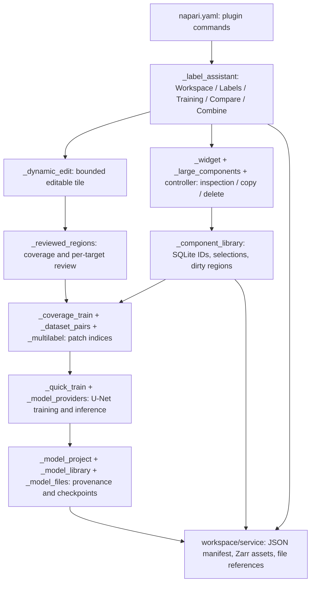

# Feature inventory and architecture

Reviewed commit: `cb95a5e97717aca24db658c488fd810647955bcd` (package declares `4.3.0`; multilabel additions are under **Unreleased**).

Initial inspection precedes execution. **Code-reviewed** below means an implementation and call path were inspected, not that every behavior passed a test. Executed results are recorded separately in `05_scientific_validation.md` and `06_testing_summary.md`. Raw function/test inventories, checksums, and line numbers are in `evidence/repository_inventory.json` and `evidence/source_index.md`.

## Architecture

The application is a Python/Qt desktop plugin, not a standalone reader or biological foundation model. NumPy, SciPy and scikit-image supply numerical operations; napari supplies rendering/native paint; Zarr stores masks and packaged images; SQLite stores stable component records. PyTorch and SMP are optional model providers. `superqt` is imported directly but provided transitively through napari. There is no repository CI workflow or supported-version matrix in this commit.

## User-facing inventory

| Feature | Purpose and implementation | User interaction / expected behavior | Existing tests | Principal failure points / initial status |
|---|---|---|---|---|
| Plugin entry points and shared panel | `napari.yaml`; `_label_assistant.py`; `_widget.py` | Open Label Curation, Model Training or Model Library; synchronize selected layer and tools | `test_label_assistant_widget`, `test_model_library` | Layer-name coupling, duplicate panels, inherited Qt state; implemented, code-reviewed |
| Workspace create/open/save | `workspace/service.py:save_workspace, load_workspace`; `_workspace_widget.py` | Persist manifest and mask stores, restore viewer/layer state and models | `test_workspace_manager`, `test_workspace_widget`, `test_model_files` | Coordinate metadata, missing assets, partial loads, write ordering and unsaved state; implemented |
| Portable package / Save As | service `_serialize_layer, create_portable_snapshot`; `_model_project.save_project` | Copy images/masks/libraries/checkpoints into relative asset folder | workspace/model management tests | Copies vs links, mutable stores, orphaned assets, failed save side effects; implemented |
| Large-image viewing pyramid | service `_persist_image_pyramid_to_zarr, _downsample_intensity_block` | Optional optimized image pyramid; preserve original full-resolution pixels | workspace manager/widget tests | Area averaging is explicit; RGBA, edges, calibration and dtypes need independent checks |
| Native/direct labels editing | napari Labels; `_dynamic_edit.resolved_editing_strategy` | Paint/erase/fill/polygon in source layer | `test_dynamic_edit` | napari/dtype limits; direct painting can modify unsaved on-disk data |
| Local-area editing | `_dynamic_edit.DynamicLabelsEditController` | Camera-centered crop; commit changed bounding box to source; automatic/manual apply, undo/redo | `test_dynamic_edit`, UX tests | Full affine vs scale/translation, concurrent edits, stale helper, bounding-box writes; implemented |
| Small connected components | `_widget._build_fast_component_index` | Analyze per nonzero label, 4-neighbor components; area/centroid/bbox/Euler table | equivalence, canvas, component widget tests | Full materialization, per-label scans, topology convention and stale indices |
| Large connected components | `_large_components.build_large_component_index`; `_large_component_controller` | Tiled seam union, disk ID maps, paged metadata; optional Euler | large component tests | Fragment metadata growth, temporary disk, dtype/copy equivalence, topology workload |
| Component copy and destination selection | `_widget._copy_selected_to_layer, _copy_mask_components_to_target`; controller `edit_components` | Copy selected IDs into chosen/created target | label-assistant and component tests | Overwrite collisions, affine compatibility, narrow integer target, no copy undo |
| Component deletion and small-object cleanup | `_widget` deletion handlers; controller `edit_components` | Remove selected components or strict area-below threshold | large widget and UX tests | Partial operations, stale index, destructive selection and undo lifetime |
| Deletion recovery | `_deletion_history.DeletionHistory` | Restore latest deletion only into still-zero pixels; disk-backed journal | `test_ux_workflows` | Single-operation/session lifetime; replaced array, concurrent writes; implemented |
| Persistent training component library | `_component_library.ComponentLibrary.update, select, verify_region`; library widget | Stable IDs, inclusion checkboxes, dirty components require re-review | component library and widget tests | SQLite integer range, reconnect semantics, full scan/update cost, cancellation |
| Grid addresses and overlays | `_grid_map.build_visible_grid_label_layout`; `_widget._grid_index_from_xy, _build_grid_shapes` | RxxCxx from centroid/cell position, semantic zoom, bounded viewport text | grid/semantic/large-grid tests | Zero-based indexing, edge truncation, rotated/sheared viewport approximation |
| Reviewed cells / next cell | `_reviewed_regions.ReviewedAreaWidget` | Confirm all targets/background in a cell; next unreviewed cell; coverage by image and truth ID | reviewed-region and UX tests | Partial review invalidation, mask association, image transform, source replacement |
| Component foreground + reviewed background | `_component_library.TrainingSupervision` | Selected objects provide positive-only supervision; known reviewed areas supply negatives | component library/coverage tests | Unknown-background leakage, verification cache and component crossing split |
| Compare display tools | `_widget.quick_compare_toggle_widget` | Show image/labels/both, dim/blink/pulse without changing pixels | label-assistant widget tests | Visibility/focus state, timer shutdown, user inference about scientifically compared values |
| Combine/reclassify/vote/consensus | `_widget._merge_binary_masks, _merge_label_layers_same_class, _compose_label_layers_distinct_classes, _count_label_votes, _consensus_label_map, _reclassify_single_value_labels` | Produce modified/new mask or vote layers | label-assistant tests (limited operation coverage) | Alignment, overlaps/later-layer priority, large allocations, negative/high values; implemented |
| Current image/label dataset | `_quick_train.prepare_crops`; `_coverage_train.index_patches`; training widget | Choose image, truth, complete or partial coverage; index or sample | quick-train, coverage, widget tests | Shape-only vs physical alignment in current-pair path; complete coverage is a user assertion |
| Multiple image/label pairs | `_dataset_pairs.resolve_pairs, DatasetPairsDialog`; `_coverage_train.index_pairs` | Include explicit pairs; per-pair coverage and image/specimen groups | `test_dataset_pairs` | Manual specimen grouping, duplicate acquisitions, missing layer IDs, split coverage |
| Binary / exclusive multiclass tasks | config and `_models_widget`; `class_targets, segmentation_loss, class_probabilities` | Empty names merges nonzero targets; names give IDs 1..K with background 0 | multiclass/quick-train tests | Class ID validity, tiny class resampling, mode consistency, unused classes |
| Overlapping multilabel tasks | `_multilabel.index_multilabel`; `_multilabel_targets` editor | Independent feature masks, binary/nonzero reads; complete/partial/unknown per channel | `test_multilabel_training` | Channel naming/ordering, unintended complete coverage, strict masks vs instance IDs |
| Task and channel setup | `_models_widget.apply_channel_names, _update_task`; `_multilabel_targets` | Name in Models or channel dialog; single-image layer-name shortcut | multilabel and model-management tests | Preserve trained meanings, explicit foreground interpretation, mask-vs-channel terminology |
| Patch preparation / preview | `_coverage_train.preview_index`; `_quick_train.build_crop_atlas`; widget gallery | Optional contact sheet, ignored-pixel masks, double-click source navigation | quick-train/dataset/multilabel widget tests | True world transform, source identity, representative vs complete coverage |
| Spatial and grouped validation | `index_patches, index_pairs, spatial_folds, partition_dataset` | Holdout or k-fold; reserve blocks or image/specimen groups | coverage, component library, dataset tests | Adjacent-patch correlation, manual groups, prior exposure and split reuse |
| U-Net providers | `_model_providers.build_model`; `_quick_train.build_unet` | Custom GroupNorm U-Net, standard BatchNorm U-Net, optional SMP/custom registered builders | model-management/multiclass tests | Output contracts, singleton batches, provider availability/version drift |
| Augmentation / optimization | `augment_batch`; `train_prepared_unet, train_indexed`; `PlateauControl` | Joint rotations/flips; image-only intensity jitter; AdamW and optional reduce-then-stop | quick-train/coverage tests | Randomness, reviewed-pixel weighting, retained checkpoint vs latest loss |
| Metrics and learning charts | `metrics_from_counts, _scores`; coverage `_validate`; `_training_report`, `_learning_chart` | Validation Dice/IoU/precision/recall/loss, per-class scores, SVG/CSV | quick-train, learning chart, multiclass/multilabel tests | Empty cases, macro vs micro conventions, absent channels, selected-validation optimism |
| Current-area / full-image / drawn-box inference | `predict_area, predict_region`; widget `_prediction_done` | One crop or overlap-blended tiles; threshold/argmax or independent channels; new Labels | quick-train and widget tests | Output RAM, local normalization, ROI affine, serialization of result transforms |
| Checkpoint save/load/continue | `save_model, load_model`; model providers/files | Restore weights/config/mode; retain best validation checkpoint; fresh optimizer | model-management/selection/files tests | Legacy version handling, corrupt payload, GPU differences, task compatibility |
| Architecture comparisons | `_model_comparison.compare_models, dataset_snapshot` | Same indexed sources/splits for candidate training; save separate report | model-management/dataset/multilabel tests | Image fingerprints, selected-validation ranking, seed/compute equivalence |
| Model catalog/file management | `_model_library.catalog`; `_model_library_widget`; `_model_files` | Browse without loading weights; import/select/export/copy/relink, notes/tags/favorites | model library/files tests | Actual checkpoint vs displayed selection, stale records, missing assets, identity changes |
| Shared Spectral Assistant state | service `_spectral_project_state` | Preserve external analysis metadata/database reference on resave | No dedicated label-assistant test found | Other plugin availability/format, missing external database; code-reviewed only |

## Explicitly unsupported or limited

- No MoE router, foundation-model biology recognition, learned instance separation, parent-cell/organellar ownership, or enforced containment.
- No independent test-set evaluator; holdout/k-fold metrics select checkpoints and are not independent test estimates.
- No automatic specimen provenance inference or duplicate-image deduplication. Shared group text is user supplied.
- No general 3D/multichannel training: training resolves a single-channel 2D highest-resolution image.
- Multilabel uses All patches, not sampled single-mask preparation. Unknown supervision is channel-specific only in multilabel mode.
- Component-table result IDs may change on reanalysis; the persistent component library uses a separate stable-ID lifecycle.
- Undo is not a persistent, multi-operation scientific audit trail; reviewed grid addresses are not reviewer-assignment/comment/history management.
- Large-image local editing/component tiling is implemented; uniform 100,000² interactive performance, full-image inference, and arbitrary hardware support are not established by this inventory.
